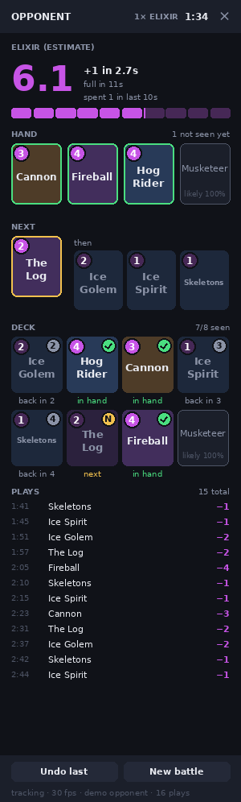

# croverlay — Clash Royale opponent overlay

A separate program from the CR bot (Solar-CR). It sits beside the Clash Royale
window and shows, live:

* **the opponent's elixir** (estimate), with time to the next point and to full
* **their current hand** — exact once their whole deck has been seen and the
  cycle is consistent, otherwise the most likely hand with per-card odds
* **their next card** and the order of the rest of the queue
* every card in their deck with *in hand* / *next* / *back in N plays*
* guesses for cards not seen yet, from the top 200 ladder decks



It only uses what is visible on your screen: the cards the opponent plays.
It does not read the game's memory or anything hidden (Solar-CR's memory
reader could see their real hand; this deliberately does not). Even so, any
third-party tool alongside Clash Royale may be against Supercell's terms of
service — use it at your own risk.

## Install

Windows, Python 3.10+, run from the root of this repository:

```powershell
pip install -r croverlay/requirements.txt
```

The overlay has no model of its own. It uses the YOLO detector you trained
for the bot, found automatically if your Solar-CR checkout sits next to this
repo (or pass `--bot-dir`, or `--weights path\to\best.pt`):

* `tmp/yolo/runs/*/weights/best.pt` (newest), else `vendor/KataCR/runs/detector*.pt`
* `tmp/yolo/side_classifier.pt` if present — the ally/enemy classifier, the
  strongest cue for whose a play was. Strongly recommended.

`python -m croverlay check` reports what it found.

## Use

```powershell
python -m croverlay --my-deck hog_rider musketeer cannon ice_golem skeletons ice_spirit the_log fireball
```

Start it before or during a battle. It finds the emulator (MuMu, BlueStacks)
or Google Play Games window, docks on its right (`--left` for the other side),
follows it when moved, hides when it is minimised, and stays on top only while
the game has focus. A battle starts when the arena appears and ends a few
seconds after it disappears, so you can leave it running across matches.

**Give it your own deck** (`--my-deck`, any spelling: `"hog rider"`, `skarmy`,
`the_log`). With your eight cards known, anything else on the board is theirs,
which removes most attribution mistakes.

| option | |
|---|---|
| `--window TITLE` | pick the window when several emulators are open |
| `--source adb --serial 127.0.0.1:16384` | capture over ADB instead (window can be hidden) |
| `--cards-dir DIR` | card images named by card (`hog_rider.png`…); BuildABot's are used if found |
| `--intro-delay S` | seconds between the arena appearing and elixir starting, if the clock looks early |
| `--device cpu` | run the detector on the CPU |

**Corrections.** Click a card on the panel to log a play the detector missed
("they just played this"); *Undo last* removes the most recent play; *New
battle* restarts the clock. Esc closes, Ctrl+Z undoes.

### Without the game

```powershell
python -m croverlay demo                    # a scripted opponent; prints its real hand to compare
python -m croverlay replay ..\Solar-CR\data\vod\tracks\Twitch_011.jsonl   # recorded detections
python -m croverlay shot TRACKS.jsonl out.png --at 90                     # one frame to a PNG
```

## How it works

```
frame ─► YOLO ─► boxes ─► tiles ─► plays ─► cycle model ─► hand, next
         (bot's   (fit to   (tracker)   └──► elixir model ─► elixir
         model)   towers)
```

* **Tiles.** Box positions are mapped to the 18×32 arena by an affine fit to
  the six crown towers, so any window size or letterbox works.
* **Plays** (`tracker.py`). Something *appearing* is not always a play: units
  are re-found after the detector loses them, buildings spawn skeletons, a
  Skeleton Army lands over several frames, a Hog crosses the river. Tracks are
  matched by class (not by half), spawner output and class flicker are
  filtered, multi-unit cards are grouped and sized (Skeletons vs Skeleton Army),
  and whose play it was is scored from the side classifier, the deploy markers
  the game draws for *your* cards, where it landed, which way a thrown spell
  flew, and both players' known decks. Deck knowledge can pick a side but never
  counts as evidence a play happened.
* **Cycle** (`cycle.py`). The game's rule is that the queue is the last four
  cards played, so any five consecutive plays are distinct. The model keeps an
  exact distribution over the 1,680 possible queues, so unseen cards, the
  unknown starting queue and plays the detector missed are handled exactly. A
  play the cycle says is impossible is either a misread (dropped) or proof that
  plays were missed (the fewest are inserted) depending on how strong it is.
* **Elixir** (`elixir.py`). 5 to start, 1 per 2.8 s, 1.4 s from 2:00 elapsed,
  0.93 s from 4:00, Elixir Collector payouts; a play proves they could afford
  it, which keeps the estimate from drifting low.

Card costs and unit counts come from the game's own tables (via Solar-CR's
`data/royaleapi`), not from memory.

## How accurate

Measured, not assumed — and on two very different inputs:

**Scripted opponents** (`python -m croverlay.demo`: 12 matches, 4 decks, the
real pipeline fed noisy detections with frames dropped at random). Hand and
next card are scored outside the ~1 s it takes to confirm each play:

| detector recall | plays caught | invented | hand cards shown right | next card right |
|---|---|---|---|---|
| 100% | 97% | 0 | 98% | 96% |
| 80% | 93% | 0 | 91% | 87% |
| 60% | 90% | 0 | 88% | 78% |

**Real matches from stream recordings** (`python -m croverlay.evaluate
..\Solar-CR\data\vod\tracks --glob "Twitch_*.jsonl"`, 62 matches). This is the
hard case: the detector was trained on emulator frames, and on stream footage
it sees about two units per frame and often names a card wrong (Dark Prince
for Hog Rider, Tesla for Cannon). For the recording player, whose deck is
known, 57% of the plays logged were real deck cards. Before the filtering
described above the extractor logged 18 plays a minute per player with 28
distinct cards and needed 33 more elixir a minute than exists; now it is 6
plays a minute. Better input helps more than anything here: on your own
emulator with the side classifier the detector is in its home domain.

## Limits

* The estimate is only as good as the plays it sees. A missed spell leaves the
  elixir high and is repaired in the cycle only when a later play contradicts
  it; click the card to log it.
* Plays are confirmed ~1 s after they land.
* The match clock starts when the arena appears; use `--intro-delay` if the
  elixir runs early. Special modes (2× / 3× elixir events, Touchdown, 2v2) are
  not modelled.
* Champion abilities, Clone, Elixir Golem's payout to you, and Mirror's exact
  cost are approximated or ignored.
* Stationary spells with no deploy marker (Tornado, Zap…) are attributed by
  where they landed using a per-spell heuristic (`catalog.SPELL_INTENT`).

## Files

| | |
|---|---|
| `__main__.py` | command line |
| `overlay.py`, `render.py` | the docked Tk window and the panel drawing |
| `winapi.py`, `sources.py` | finding and capturing the game window, ADB, video |
| `detector.py` | YOLO and the side classifier, boxes → tile detections |
| `geometry.py` | arena coordinates and the tower fit |
| `tracker.py` | detections → plays |
| `cycle.py`, `elixir.py`, `predict.py` | hand/next, elixir, unseen-card guesses |
| `match.py`, `pipeline.py` | per-battle state, session lifecycle, worker thread |
| `demo.py`, `evaluate.py` | scripted opponent, replay scoring |

Tests: `python -m pytest croverlay/tests`
